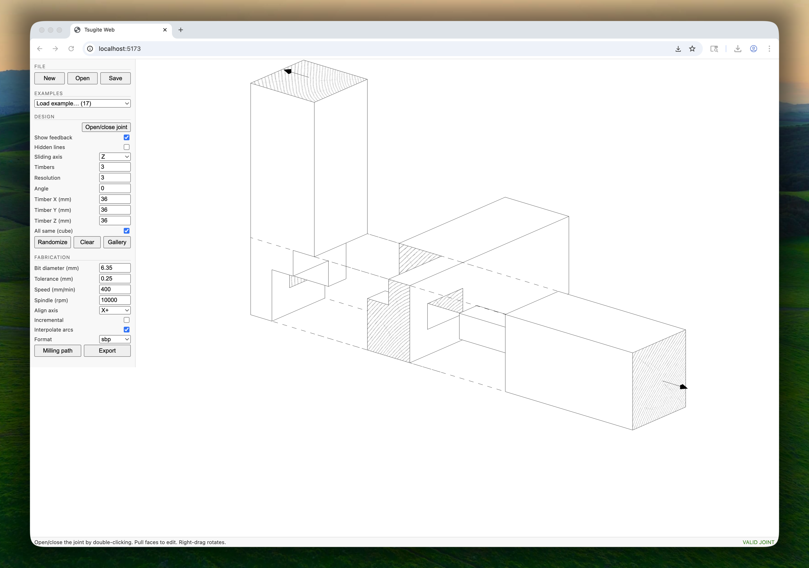

# Tsugite Web



Web reimplementation of [Tsugite](https://github.com/marialarsson/tsugite)
(UIST 2020) — interactive design and fabrication of wood joints — in
TypeScript + Vite + three.js. The original Python/PyQt5/OpenGL app is ported
module-by-module with parity tests against its own code and exported files.

## Run

```sh
pnpm install
pnpm dev        # dev server
pnpm test       # parity + unit tests (vitest)
pnpm typecheck  # strict TS
pnpm build      # production build
```

## Use

- **Double-click / Space** — open/close the joint
- **Hover + drag** a top face (joint open) — push/pull geometry
- **Shift** — select all same-height faces
- **Drag** a component body — move/rotate it (L/T configurations)
- **Right-drag** — rotate the view
- **r / c** — randomize / clear geometry, **h** hidden lines, **f** feedback,
  **m** milling path, **g** export machine files
- Left panel: design + fabrication parameters, file open/save (`.tsu`,
  compatible with the original), export (gcode / nc / sbp)
- Right panel: valid-joint suggestions when the current joint is invalid
  (computed in a Web Worker); click to adopt

Real-time feedback mirrors the original: unconnected voxels (red), unbridged
parts (pastel pairs), checkerboard warnings, fragile grain (yellow),
unfabricatable components (orange), sliding arrows (red when not
interlocked).

## Structure

- `src/model/` — pure core: height fields, voxel matrix, full `Evaluation`
  port, suggestions, `Joint` aggregate (no three.js imports)
- `src/io/` — `.tsu` parse/serialize
- `src/fab/` — milling path pipeline + G-code/SBP/NC writers (no three.js)
- `src/view/` — vertex/index builders ported from the original, three.js
  renderer, GPU picking, overlays
- `src/interaction/` — selection state machine
- `src/ui/` — control panel, suggestion panel
- `tests/` — parity fixtures generated by running the ORIGINAL Python
  evaluation (`scripts/gen_eval_fixtures.py`) + machine-file comparisons

See `PLAN.md` for the porting plan, `PARITY.md` for known divergences, and
`CHANGELOG.md` for per-phase details.

## License

The original Tsugite is free for personal use and non-commercial research;
the same terms apply to this port. See the original repository's LICENSE.
